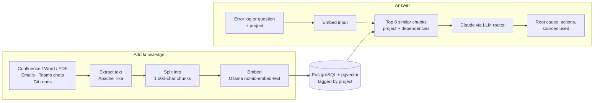

# AIOps Platform — POC

Upload a project's Confluence pages, emails, Teams chats and code. Paste an error log or ask a question, and the platform finds the most relevant passages from that project and has Claude answer from them, listing the sources it used.

- **Projects** keep knowledge separate. A question searches the selected project plus the upstream/downstream projects it depends on.
- **Any document format**: PDF, Word, HTML, Markdown, text, emails (`.eml`, `.msg`), or pasted text. Git repositories can be synced by URL.
- **Grounded answers**: the model is told to answer only from retrieved context and to say when the context does not cover the question.
- **Local embeddings**: documents are vectorised on your machine by Ollama; only the few relevant passages are sent to the LLM.

---

## How it works



| Layer | Technology |
|---|---|
| Backend | Java 17, Spring Boot 3.3.5 |
| Knowledge store | PostgreSQL 16 + pgvector (Docker), Flyway migrations |
| Embeddings | Ollama `nomic-embed-text` (768 dimensions, runs locally) |
| LLM | Anthropic Claude (default); OpenAI-compatible or local Ollama, switchable in the UI |
| Text extraction | Apache Tika |
| UI | Single static page (`src/main/resources/static/index.html`), plain JavaScript |
| Demo stubs | WireMock on port 8089 (fakes Confluence, Teams and Outlook APIs) |

---

## Install on a new machine

### 1. Prerequisites

| Tool | Version | Check | Install |
|---|---|---|---|
| Git | any | `git --version` | [git-scm.com](https://git-scm.com) |
| Java JDK | 17 or newer | `java -version` | [adoptium.net](https://adoptium.net) |
| Maven | 3.9+ | `mvn -version` | [maven.apache.org](https://maven.apache.org/download.cgi) |
| Docker Desktop | any | `docker info` | [docker.com](https://www.docker.com/products/docker-desktop) |
| Ollama | any | `ollama list` | [ollama.com](https://ollama.com/download) |

You also need an **Anthropic API key**: [console.anthropic.com](https://console.anthropic.com) → API Keys.

### 2. Get the code

```bash
git clone <your-repository-url> aiops
cd aiops
```

### 3. Add your secrets in a local `.env` file

```bash
# Windows (PowerShell or cmd)
copy .env.example .env

# macOS / Linux
cp .env.example .env
```

Open `.env` and set your key:

```properties
ANTHROPIC_API_KEY=sk-ant-...
```

`.env` is git-ignored and stays on this machine. See [Secrets and configuration](#secrets-and-configuration) for all settings.

### 4. Start the database

Make sure **Docker Desktop is running** first, then:

```bash
docker compose up -d
docker ps          # expect: aiops-postgres   Up ... (healthy)
```

The database name, user and password come from `.env` (`DB_NAME`, `DB_USERNAME`, `DB_PASSWORD`).

### 5. Start Ollama and download the embedding model

```bash
ollama pull nomic-embed-text
```

On Windows and macOS the Ollama app runs in the background after install. If `ollama list` reports it cannot connect, run `ollama serve` in a separate terminal.
`llama3` is only needed if you switch the answering model to Ollama (`ollama pull llama3`).

### 6. Run the app

Run from the project folder, so the app finds `.env`:

```bash
mvn spring-boot:run
```

The first run downloads dependencies and takes a few minutes. Wait for:

```
Started AiopsApplication in X seconds
```

On first start it also loads a small demo knowledge base (sample payment-service runbooks, Teams messages and emails).

### 7. Open it

- App: **http://localhost:8080**
- Health check: http://localhost:8080/actuator/health
- Confirm the key loaded: http://localhost:8080/api/llm/settings shows a masked `apiKeyMasked` under `anthropic`.

### Stopping and restarting

- Stop the app: `Ctrl+C` in its terminal. Start again with `mvn spring-boot:run`.
- Stop the database: `docker compose stop` (data is kept in the `pgdata` volume). Start again with `docker compose up -d`.
- Java or `application.properties` changes need an app restart. Changes to `index.html` only need a browser refresh (`Ctrl+F5`).

---

## Using the app

1. **📁 Projects → ➕ Add New Project**, give it a name, save.
2. On the project, click **👁 Details → Add Knowledge**:
   - choose a type: Confluence page, Email, Teams chat or Other document
   - upload files (PDF, Word, HTML, `.eml`, `.msg`, Markdown, text) or paste text
   - re-uploading a file with the same name replaces the old version; 🗑 removes a document
3. Optional: **✏ Edit** the project to add Git repository URLs or upstream/downstream projects, then **🔄 Sync**.
4. Click **💬 Ask** on the project (or pick it in the **Project** dropdown), paste an error log or type a question, and click **Analyze with AI**. The sources searched are listed under the answer.

Confluence pages are best uploaded as **Word exports** (page menu **••• → Export → Export to Word**). A browser "Save page as HTML" also works but includes the site's navigation text.

---

## Secrets and configuration

**Rule: real keys never go into a committed file.** `src/main/resources/application.properties` is committed and contains only `${ENV_VAR:default}` placeholders.

Each value is resolved in this order:

1. a real **environment variable** (use this on servers, CI and containers)
2. the local **`.env`** file in the folder the app is started from (git-ignored)
3. the **default** after the `:` in `application.properties` (safe demo values only)

`.env` is plain `KEY=value` lines: no quotes, no `export`, no spaces around `=`. Docker Compose reads the same file, so the database settings stay in one place.

| Variable | Required | Default | Used for |
|---|---|---|---|
| `ANTHROPIC_API_KEY` | **yes** | — | Claude answers |
| `DB_NAME` | no | `aiops` | Database created by Docker Compose |
| `DB_USERNAME` | no | `aiops` | App and Docker Compose |
| `DB_PASSWORD` | no | `aiops123` | App and Docker Compose. Change it for any shared environment |
| `DB_URL` | no | `jdbc:postgresql://localhost:5432/aiops` | App database connection (keep the name in sync with `DB_NAME`) |
| `OPENAI_API_KEY` | no | — | Only if the OpenAI-compatible provider is selected |
| `CONFLUENCE_BASE_URL`, `CONFLUENCE_USERNAME`, `CONFLUENCE_API_TOKEN`, `CONFLUENCE_SPACE_KEY` | no | WireMock demo stub | Live Confluence sync |
| `MICROSOFT_AUTH_BASE_URL`, `MICROSOFT_GRAPH_BASE_URL`, `MICROSOFT_TENANT_ID`, `MICROSOFT_CLIENT_ID`, `MICROSOFT_CLIENT_SECRET` | no | WireMock demo stub | Live Teams and Outlook sync |
| `DATADOG_API_KEY`, `DATADOG_APP_KEY` | no | `placeholder` | Datadog polling (off by default: `datadog.polling.enabled=false`) |

Setting a variable without a `.env` file:

```powershell
# Windows PowerShell — current terminal only
$env:ANTHROPIC_API_KEY = "sk-ant-..."
mvn spring-boot:run
```

```bash
# macOS / Linux — current terminal only
export ANTHROPIC_API_KEY=sk-ant-...
mvn spring-boot:run
```

A key typed into the in-app **🧠 LLM Settings** dialog is kept in memory only and is lost on restart. It is never written to disk.

### If a key is ever committed or shared

Removing it from the file is not enough, because it stays in Git history. **Revoke it** in the provider's console (for Anthropic: console.anthropic.com → API Keys), create a new one, and put the new one in `.env`.

---

## Pushing to Git

`.gitignore` already excludes `.env`, `target/`, IDE folders and `.claude/settings.local.json` (Claude Code's local permission file, which can contain commands with keys in them).

First push:

```bash
git init
git add .
git status                      # .env must NOT be listed; .env.example should be
git grep -n "sk-ant-" -- .      # must print nothing
git commit -m "Initial commit"
git branch -M main
git remote add origin <your-repository-url>
git push -u origin main
```

Before every later push, run the same two checks (`git status`, `git grep -n "sk-ant-"`).

---

## REST API

| Method | Endpoint | Purpose |
|---|---|---|
| GET, POST | `/api/applications` | List or create projects |
| PUT, DELETE | `/api/applications/{id}` | Edit or delete a project (its knowledge is deleted with it) |
| POST | `/api/applications/{id}/documents` | Upload files: multipart `files` (one or more) + `source` (`CONFLUENCE`, `OUTLOOK`, `TEAMS`, `DOCUMENT`) |
| POST | `/api/applications/{id}/documents/text` | Add pasted text: JSON `source`, `title`, `text` |
| DELETE | `/api/applications/{id}/documents?source=&documentKey=` | Remove one document |
| GET | `/api/applications/{id}/knowledge` | A project's stored knowledge, grouped by source |
| POST | `/api/applications/{id}/sync` | Pull configured Confluence URLs, Teams, mailbox and Git repos |
| POST | `/api/demo/simulate-error` | Answer an error or question: JSON `errorMessage`, optional `applicationId`; returns `suggestion` and `sources` |
| GET | `/api/demo/sample-errors` | Sample error messages used by the UI |
| GET | `/api/demo/knowledge-base` | All knowledge, grouped by source |
| POST | `/api/demo/reseed` | Clear and reload the demo knowledge base |
| POST | `/api/suggest` | Suggestion for a raw error (all knowledge) |
| GET | `/api/alerts`, `/api/alerts/{id}` | Processed alert history |
| GET, POST | `/api/llm/settings` | Read or switch LLM provider, model and key at runtime |

Example:

```bash
curl -X POST http://localhost:8080/api/demo/simulate-error \
  -H "Content-Type: application/json" \
  -d '{"errorMessage":"HikariPool-1 - Connection is not available, request timed out after 30000ms"}'
```

---

## Project structure

```
.env.example                 template for local secrets (copy to .env)
docker-compose.yml           PostgreSQL 16 + pgvector
src/main/java/com/aiops/
├── controller/              REST endpoints (projects, ingestion, suggestions, LLM settings)
├── demo/                    demo endpoints, demo data seeder, WireMock stubs
├── entity/ repository/      JPA entities and repositories
└── service/
    ├── ActionSuggestionService.java   retrieval + prompt + answer
    ├── VectorStoreService.java        pgvector writes and project-scoped search
    ├── OllamaService.java             embeddings
    ├── llm/                           Anthropic, OpenAI-compatible and Ollama clients + router
    └── ingestion/                     file upload (Tika + chunking), Confluence, Teams, Outlook, Git
src/main/resources/
├── application.properties   configuration with ${ENV_VAR:default} placeholders
├── db/migration/            Flyway schema V1–V7
└── static/index.html        the UI
```

---

## Troubleshooting

| Symptom | Fix |
|---|---|
| `failed to connect to the docker API ... dockerDesktopLinuxEngine` | Docker Desktop is not running. Start it, wait until it says *running*, then `docker compose up -d`. |
| App fails on startup with a connection error to `localhost:5432` | The database is not up: `docker compose up -d`, then `docker ps`. |
| `Port 8080 was already in use` | Another copy is running. Stop it, or on Windows: `Get-NetTCPConnection -LocalPort 8080 -State Listen \| % { Stop-Process -Id $_.OwningProcess -Force }` |
| Answers fail with *401* / authentication error | `ANTHROPIC_API_KEY` is missing or wrong. Check `/api/llm/settings`; make sure you started the app **from the project folder** so `.env` is found. |
| Uploads or questions fail with a connection error to `localhost:11434` | Ollama is not running or the model is missing: `ollama list`, `ollama pull nomic-embed-text`. |
| Knowledge panel is empty after first start | Ollama was not running when the app started. Start Ollama, then `POST /api/demo/reseed` or restart the app. |
| `password authentication failed for user` | `DB_USERNAME` / `DB_PASSWORD` in `.env` differ from the ones the database volume was created with. Put the old values back, or reset the database with `docker compose down -v` (**deletes all stored knowledge**). |

---

## Current limits

- Git sync indexes at most 40 files per repository, the first 6,000 characters of each, from public repositories only.
- Answers use uploaded knowledge only; the app does not query live databases, metrics or Datadog logs at question time.
- Live Teams, Outlook and Confluence sync need real credentials; demo mode uses WireMock stubs and file uploads.
- No sign-in or per-user permissions; run it on a trusted network.
- No automated tests yet.

---

## Microsoft Graph app registration (for real Teams and Outlook)

1. [portal.azure.com](https://portal.azure.com) → Microsoft Entra ID → App registrations → New registration. Name: `aiops-poc`, accounts in this organization only.
2. Certificates & secrets → New client secret → copy the value.
3. API permissions → Microsoft Graph → Application permissions: `ChannelMessage.Read.All`, `Mail.Read`, `Team.ReadBasic.All` → **Grant admin consent**.
4. Put tenant ID, client ID and secret in `.env` (`MICROSOFT_TENANT_ID`, `MICROSOFT_CLIENT_ID`, `MICROSOFT_CLIENT_SECRET`) and point `MICROSOFT_AUTH_BASE_URL` / `MICROSOFT_GRAPH_BASE_URL` at the real endpoints.

---

## Related projects

| Project | Similarity | Link |
|---|---|---|
| RAGFlow | General-purpose RAG engine with Confluence sync | [github.com/infiniflow/ragflow](https://github.com/infiniflow/ragflow) |
| IncidentBot | Incident management with Confluence + Jira | [github.com/incidentbot/incidentbot](https://github.com/incidentbot/incidentbot) |
| awesome-LLM-AIOps | Research list for LLMs in AIOps | [github.com/Jun-jie-Huang/awesome-LLM-AIOps](https://github.com/Jun-jie-Huang/awesome-LLM-AIOps) |

---

## Author

Atul — Java Technical Lead & Microservice Architect  
Stack: Java 21 · Spring Boot · Kafka · AWS · Angular · pgvector · LangChain4j
